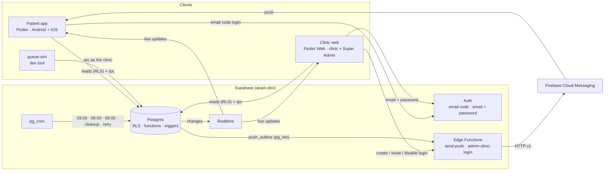

# ARCHITECTURE — Asani (Supabase, D-52)

The backend moved from Firebase to Supabase in November 2026 (PRD D-52, docs/10-supabase-migration.md). The Firebase
version of this file is in git history. Firebase is still used for **push only** (FCM, free Spark plan).

---

## 1. System overview

**Key idea:** clients **read** tables directly (Row Level Security decides what each login sees; Realtime streams the
changes) and **every important write is a Postgres function** (`supabase.rpc`), so token numbers stay atomic and the
rules live in one place. Direct client writes are only: own account settings, own devices, own family profiles.

| Writes a client does directly | Only Postgres functions / triggers do |
|---|---|
| `users`: name, city, consent, queue alerts, notifications seen-at | tokens, queue days, numbers, statuses |
| `devices`: own FCM token | `notified`, inbox, push outbox |
| `patients`: add / edit / soft-delete own family (owner, phone, status filled by the DB) | follow-ups, doctors, PIN, billing, links |

---

## 2. Components

| Component | Tech | Responsibility |
|---|---|---|
| Patient app | Flutter, Riverpod, go_router, `supabase_flutter` | Email code login, booking, live queue, family, pushes |
| Clinic web | Flutter Web, Riverpod, go_router, `supabase_flutter` | Queue board, walk-ins, doctors, billing; Super Admin screens |
| `asani_core` / `asani_ui` | Dart / Flutter packages | Shared models, rules, dates, theme |
| Supabase Auth | email OTP (patients), email + password (clinics) | Identity; roles in `app_metadata` |
| Postgres | 17, RLS on every table | All data and business rules (DATABASE.md) |
| Realtime | `postgres_changes` with RLS | Live board, live token screen |
| Edge Functions | Deno | `send-push` (FCM HTTP v1), `admin-clinic-login` (Auth admin API) |
| pg_cron | | Auto-close, reminders, billing, cleanup, push retry |
| FCM | Firebase Spark | Delivering pushes to phones |

---

## 3. Key flows

### 3.1 Patient login (D-52)
1. "Continue with email" → `signInWithOtp(email)` → Supabase emails a 6-digit code (Brevo SMTP), valid 10 minutes.
2. `verifyOTP(email, code, type: email)` → session.
3. No `users` row yet → profile setup → `create_profile(name, age, gender, phone)` creates the account row and the
   Self profile in one transaction (`phone_verified = false`; `phone-taken` if another account has the number).
4. The phone saves its Firebase Installation ID in `devices` after sign-in (D-61). Clinic / Super Admin logins are refused by the app.

### 3.2 Booking
`book_token(clinic, doctor, patient, date)`: locks the doctor's queue-day row, checks BR-1…BR-6, number = last + 1,
inserts the token. A unique index on (doctor, date, number) is a second guard. Tested with 20 parallel bookings
(`tools/db-test/concurrency.js`).

### 3.3 Queue moves → notifications
Any token status change → trigger `on_token_status` recomputes `queue_days.active_numbers`; a queue-day change →
`on_queue_day_change` → `evaluate_queue`: each waiting token gets the one step that applies (3 / 2 / 1 ahead, D-39
"You're next" at 0 ahead with someone at the doctor, "Your turn now" when called). The step is marked in `notified`,
the inbox row and the `push_outbox` row are written **in the same transaction**, so a step is never sent twice.
Skip → "You missed your turn" (D-34); clinic cancel → "cancelled by clinic" (D-23); both once per token.

### 3.4 Sending a push
`push_outbox` insert → statement trigger → `pg_net` POST to `send-push` (after commit) → `claim_push_batch`
(`skip locked`) → FCM HTTP v1 per device (Android channel `queue_alerts` or `follow_ups`) → `finish_push` (done, or
released for a retry; dead tokens deleted). `asani-retry-push` (every minute) retries, max 5 tries. Queue pushes respect
the account's queue-alerts switch (D-18); the inbox entry is always written (D-45).

### 3.5 Clinic web
Email + password; role from `app_metadata`. The repository keeps a live cache filled by Realtime streams (filters on
`clinic_id`, `date`, `month`, or none + RLS) and calls the Postgres functions for every action. Invite and reset links
land on the web root and show "Set your Asani password" first. New clinics and their logins go through the
`admin-clinic-login` Edge Function (rolls back if the invite fails).

### 3.6 Scheduled jobs (`pg_cron`, UTC)
| Job | PKT | What |
|---|---|---|
| `asani-auto-close-tokens` | 03:00 | Past-day open tokens: Booked → No-show, others → Completed (D-21) |
| `asani-billing-jobs` | 06:00 | Pilot end, monthly invoices, overdue → grace → suspended |
| `asani-follow-up-reminders` | 09:00 | Tomorrow / today reminders, past due → missed |
| `asani-cleanup` | 04:00 | Inbox > 30 days, sent pushes > 7 days |
| `asani-retry-push` | every minute | Unsent pushes |

---

## 4. App structure

Feature-first, **UI → provider → repository → backend** in both apps.
- Patient app: `lib/data/repositories/repositories.dart` (contracts), `lib/data/supabase/` (Supabase),
  `lib/data/demo/` (in-memory demo, default build), `lib/data/firebase/` (old, to be removed).
  `--dart-define=BACKEND=supabase`.
- Clinic web: `lib/data/clinic_repository.dart` (contract), `supabase_clinic_repository.dart`,
  `demo_clinic_repository.dart`, `firebase_clinic_repository.dart` (old). `--dart-define=BACKEND=supabase`.
- Widgets never import `supabase_flutter`; repositories return `asani_core` models.

**Realtime rule (found 2026-11-25):** filters on uuid columns and on `id` never fire. Stream on `clinic_id`, `doctor_id`,
`date`, `city`, `month`, `active`, or unfiltered and let RLS limit the rows.

**"Patients ahead"** = `queue_days.active_numbers` below my number: the token screen needs only the own token row and the
queue-day row, never other patients' tokens.

---

## 5. Environments and secrets

| | `asani-dev` (Supabase) | prod (later) |
|---|---|---|
| Region | Tokyo `ap-northeast-1` | Mumbai `ap-south-1` |
| Who changes it | Sarbuland / agents when asked | Sarbuland only |
| Push | FCM of `asani-b2b17` (Spark) | FCM of the prod Firebase project |

Local, git-ignored: `supabase/.db-url.local` (DB URL), `supabase/.access-token.local` (CLI token: Edge Functions +
Secrets), `tools/admin-scripts/serviceAccount.dev.json`, `tools/admin-scripts/dev-test-logins.local.txt`.
Supabase Vault: `push_url`, `push_secret`. Edge Function secrets: `PUSH_SECRET`, `FCM_SERVICE_ACCOUNT` (base64),
`CLINIC_WEB_URL`. Public in the apps: project URL + publishable key.

---

## 6. Time, offline, scale

- All business dates are Asia/Karachi; never use the device time zone for day IDs (`asani_core` dates,
  `private.pkt_today()` in SQL; tests pin the clock with `asani.test_now`).
- Offline: screens keep the last data in memory with the offline banner; booking needs internet.
- Free plan limits to watch: the project **pauses after 1 week without use** (decide Pro or a keep-alive before the
  pilot, S-7), no daily backups, Realtime 200 connections, email 300/day (Brevo).
