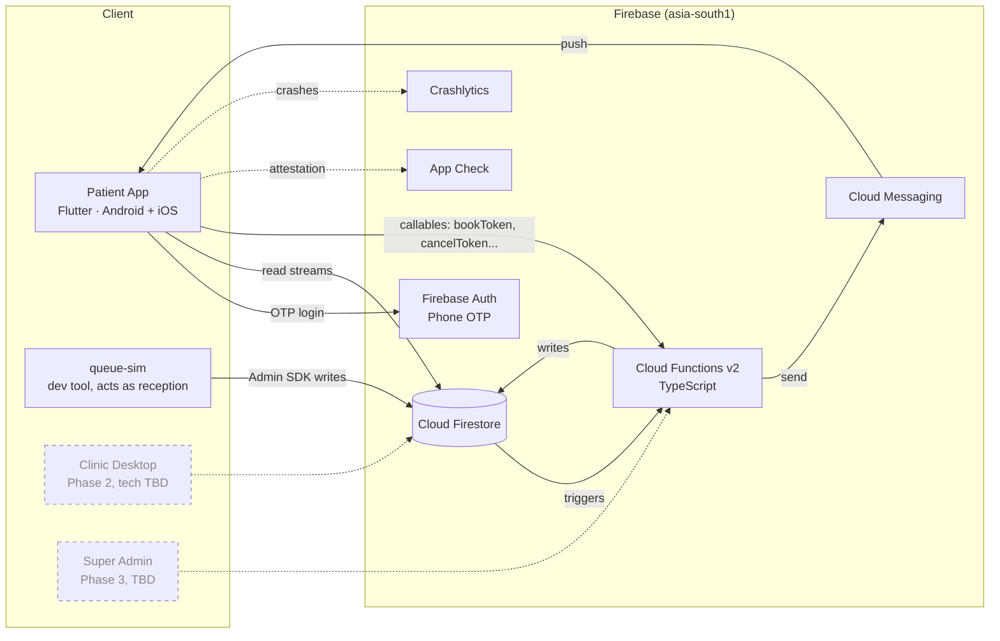
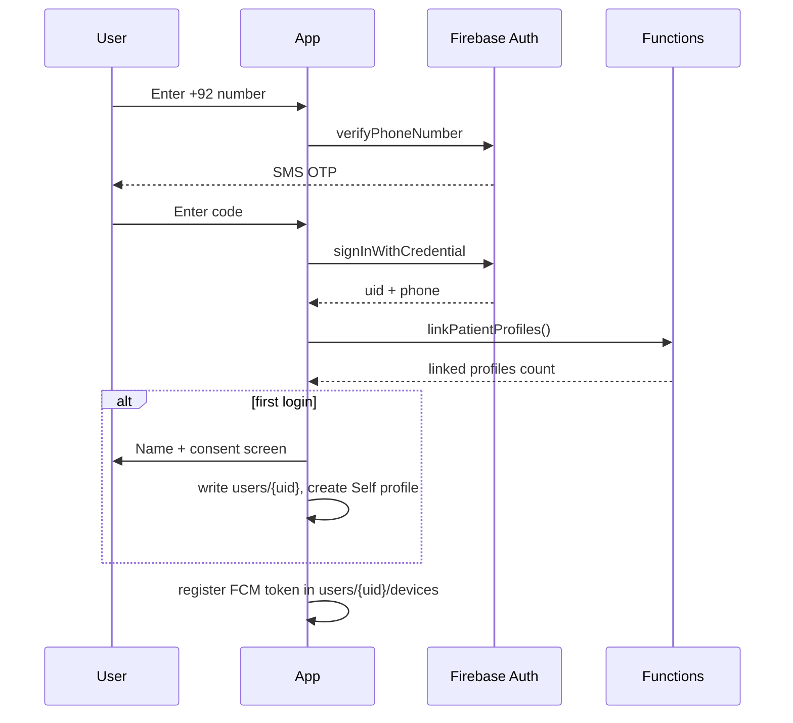
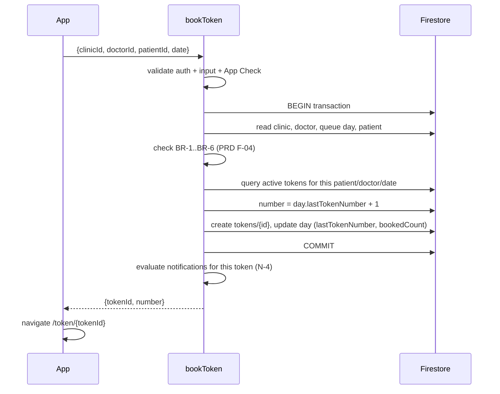
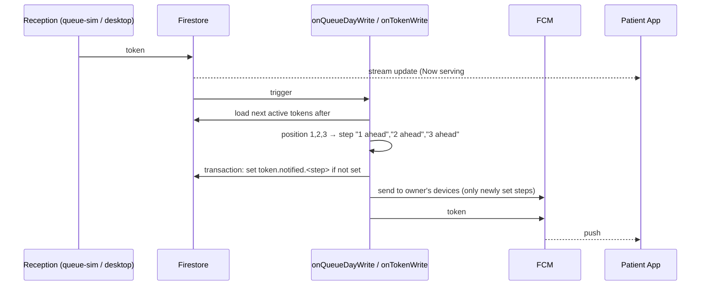

# ARCHITECTURE — Asani (Phase 1: Patient App)

---

## 1. System overview



**Key idea:** the patient app **reads** directly from Firestore (fast, real-time, offline cache) but **every important write goes through a Cloud Function** (booking, cancelling, linking, account deletion). This keeps token numbers correct and business rules in one place, which the future desktop app will also rely on.

| Writes the app does directly | Writes only Cloud Functions do |
|---|---|
| Own `users/{uid}` profile (name) | `tokens` (create, cancel) |
| Own device FCM tokens | Queue day counters |
| Own `patients` profiles (create/edit/soft-delete) | `token.notified` |
| | Linking profiles, account deletion |
| | Follow-up status changes |

---

## 2. Components

| Component | Tech | Responsibility |
|---|---|---|
| Patient App | Flutter, Riverpod, go_router | UI, local state, reading streams, calling functions, receiving pushes |
| `asani_core` | Dart package | Models, enums, constants, date helpers shared with the future desktop app |
| Firebase Auth | Phone provider | Patient identity (uid + phone number) |
| Firestore | Native mode, `asia-south1` | All data. See DATABASE.md |
| Cloud Functions | v2, Node 20+, TypeScript | Business rules, triggers, scheduled jobs, notifications |
| FCM | HTTP v1 via Admin SDK | Queue and follow-up push notifications |
| App Check | Play Integrity (Android), App Attest/DeviceCheck (iOS) | Block requests from non-genuine apps; protects OTP and functions |
| Crashlytics | | Crash and non-fatal error reporting |
| queue-sim | Node + Admin SDK | Developer tool that moves the queue exactly like the desktop app will |

---

## 3. Key flows

### 3.1 Login



### 3.2 Booking a token



The transaction guarantees two simultaneous bookings never get the same number (Firestore retries on contention).

### 3.3 Queue moves → notifications



**Notification algorithm** (`functions/src/queue/notify.ts`), runs after any change to a queue day or token status:

```
activeAhead = tokens where doctorId, date, status in [booked, arrived, onHold]
              and number > currentToken, ordered by number ASC, limit 3
for i, token in activeAhead (i = 0..2):
    position = i + 1                         # patients ahead of this token
    step = "ahead" + position
    stepsToMark = steps from the first unsent one down to `step`
      (e.g. jump from 4 → 1 ahead marks ahead3, ahead2, ahead1)
    in a transaction: if token.notified[step] is empty →
        set notified[step] = now, also set any skipped higher steps
        send ONLY `step`
if a token's status changed to `called` and notified.yourTurn is empty:
    set notified.yourTurn, send "Your turn now"
```

Note: "ahead" counts the patient currently `called` as not ahead, because they are already with the doctor.

Idempotency: the `notified` map is the guard; re-running the trigger sends nothing new.

### 3.4 Cancelling

App → `cancelToken({tokenId})` → function checks the caller owns the token and status is `booked`/`arrived` → status `cancelled` → `onTokenWrite` recomputes `activeNumbers` and re-evaluates the queue (patients behind may get their next step).

### 3.5 Follow-up reminders

Scheduled function `followUpReminders` runs daily at **09:00 Asia/Karachi**:
- `dueDate == tomorrow` and `remindersSent == 0` → "Follow-up visit tomorrow"
- `dueDate == today` and `remindersSent < 2` and status `pending` → "Follow-up visit today"
- `dueDate < today` and status `pending` → status `missed` (no notification)

Notification data carries `{type: "followUp", followUpId}`; the app opens booking pre-filled.

### 3.5b Clinic cancel notice (PRD D-23)

`queueAction` (`cancel`) and `cancelDoctorTokens` call `notifyClinicCancel` (`functions/src/queue/cancelNotice.ts`)
after the write. For each token cancelled by the clinic it claims `cancelNotifiedAt` in a transaction, then sends one
push to `bookedByUserId ?? patientOwnerUid`: "Token A-5 cancelled by Al-Shifa Clinic" / "{reason}. Tap to book another
day.", data `{type: "cancel", tokenId, route: "/book/{clinicId}/{doctorId}?patient={patientId}"}`. Not counted in the
4 queue notifications, not blocked by the queue-alerts switch (like follow-up reminders). No push for No-show.

### 3.6 Closing old tokens (PRD D-21)

Scheduled function `autoCloseTokens` runs daily at **03:00 Asia/Karachi** (`functions/src/queue/autoClose.ts`).
It reads the active tokens (`booked`, `arrived`, `onHold`, `called`) and closes only those whose `date` is **before
today**: Booked → `noShow`; Arrived, On hold, Called → `completed`. Each gets `autoClosed: true` and a history line
by "System"; the past `days/{date}` docs get `activeNumbers: []`. No notifications. Safe to run again. Until Blaze
it is run by hand: `tools/admin-scripts/run-auto-close.js --project dev`.

---

## 4. Patient app structure

Feature-first, three layers: **presentation → application (providers) → data (repositories)**.

```
apps/patient_app/lib/
├── main.dart                     # bootstrap: Firebase.init, App Check, Crashlytics, env
├── app.dart                      # MaterialApp.router, theme
├── core/
│   ├── config/env.dart           # ENV, USE_EMULATOR from --dart-define
│   ├── router/app_router.dart    # go_router, auth redirect, deep links
│   ├── theme/                    # colors.dart, typography.dart, spacing.dart, app_theme.dart
│   ├── utils/                    # logger.dart, date_utils.dart (Asia/Karachi), phone_utils.dart
│   ├── errors/                   # AppException, mapping from FirebaseFunctionsException
│   └── widgets/                  # StatusChip, SkeletonCard, EmptyState, ErrorState, OfflineBanner
├── data/
│   ├── repositories/
│   │   ├── auth_repository.dart
│   │   ├── clinic_repository.dart
│   │   ├── doctor_repository.dart
│   │   ├── queue_repository.dart     # streams doctors/{id}/days/{date}
│   │   ├── token_repository.dart     # streams tokens, calls book/cancel
│   │   ├── patient_repository.dart
│   │   └── followup_repository.dart
│   └── services/
│       ├── functions_service.dart    # typed wrappers for callables
│       └── push_service.dart         # FCM + flutter_local_notifications
└── features/
    ├── auth/        (phone, otp, profile_setup)
    ├── home/
    ├── search/
    ├── clinic/
    ├── booking/     (patient_step, date_step, confirm_step)
    ├── token/       (live token screen)
    ├── tokens/      (tab)
    ├── family/      (list, detail, form)
    ├── followups/
    └── account/
```
Each feature folder: `presentation/` (screens, widgets) and `application/` (Riverpod providers/notifiers).

**Rules:**
- Widgets never import `cloud_firestore` or `cloud_functions`.
- Repositories return `Stream`/`Future` of models from `asani_core`.
- Providers handle `AsyncValue` loading/error states; screens render them using the shared state widgets.

### State management (Riverpod)
- `authStateProvider` (StreamProvider<User?>) drives router redirects.
- `currentUserProvider`, `myPatientsProvider`, `myActiveTokensProvider` (streams).
- `clinicsProvider(city)`, `clinicSearchProvider(query)` (client-side filter for MVP).
- `doctorsProvider(clinicId)`, `queueDayProvider((doctorId, date))`.
- `tokenProvider(tokenId)` stream + derived `tokenPositionProvider` (patients ahead, estimated wait).
- `bookingFlowNotifier` holds the booking draft (doctor, patient, date) across steps.

### Computing "patients ahead" in the app
The token screen needs the same number the function uses, **without reading other patients' tokens** (they contain names and phone numbers, and Firestore rules cannot allow a `count()` without also allowing reads).

So the queue day doc carries a **numbers-only** list, `activeNumbers` (token numbers in `booked` / `arrived` / `onHold`, sorted). The app computes:
```
ahead = activeNumbers.where((n) => n < myNumber).length
estimatedWait = ahead × doctor.avgConsultMinutes
```
`activeNumbers` and `waitingCount` are maintained by the `onTokenWrite` trigger (recomputed from the tokens query inside a transaction), so any client that changes a token's status (queue-sim now, desktop later) keeps it correct automatically. The token screen therefore needs only **two listeners**: its own token doc and the day doc.

---

## 5. Cloud Functions (Phase 1)

`functions/src/`

| Name | Type | Purpose |
|---|---|---|
| `bookToken` | callable | Validate rules BR-1..BR-6, assign number in a transaction, create token |
| `cancelToken` | callable | Patient cancels own token |
| `linkPatientProfiles` | callable | Attach unowned `patients` with the caller's phone to the caller |
| `deleteAccount` | callable | Remove user, devices; anonymise app-created profiles; delete Auth user |
| `onQueueDayWrite` | Firestore trigger `doctors/{doctorId}/days/{date}` | Re-evaluate queue notifications |
| `onTokenWrite` | Firestore trigger `tokens/{tokenId}` | "Your turn now"; recompute `day.activeNumbers` + `waitingCount`; re-evaluate notifications on cancel/skip |
| `followUpReminders` | scheduled, daily 09:00 PKT | Follow-up reminders + mark missed |
| `autoCloseTokens` | scheduled, daily 03:00 PKT | Close past-day open tokens (D-21, §3.6) |
| `cleanupStaleDevices` | scheduled, weekly | Remove FCM tokens that FCM reports as unregistered |

### Clinic web functions (PRD-CLINIC-WEB §11)

Roles are custom claims (`role: clinic` + `clinicId`, or `role: superAdmin`), checked in `lib/access.ts`.
Every change writes an `activityLogs` row (BW-10). Because Firestore triggers only run after Blaze,
each callable also recomputes `day.activeNumbers` and calls `evaluateQueue` itself (same as `bookToken`).

| Name | Who | Purpose |
|---|---|---|
| `queueAction` | clinic | `start`/`pause`/`end`/`next`/`undo` (30 s) and token actions `arrive`, `callNow`, `skip`, `hold`, `backToQueue`, `cancel`, `noShow`, `reprint`; history on the token. **Next (D-24, `clinic/nextOrder.ts`)**: a Skipped patient who checked in again (`priorityAt`) first, else the lowest number among Booked + Arrived; if that token is Booked the call fails with `details.code = "not-arrived"` (nothing written) until the web sends `callNotArrived: tokenId` ("Call anyway") or skips it. `arrive`/`backToQueue` from Skipped set `priorityAt` |
| `clinicCreateWalkIn` | clinic | Walk-in token, same numbering as `bookToken` (BW-2), status `arrived`; creates the patient if new. A profile from `clinicLookupPhone` not yet at this clinic needs the matching full `phone` (D-22); the clinic is added to its `clinicIds` |
| `clinicLookupPhone` | clinic | D-22: profiles on a **full** phone number from any clinic, returning only `id, name, relation, gender, age, atThisClinic`. Rate limit 30 lookups / 10 min per clinic (`rateLimits/phoneLookup_{clinicId}`) |
| `clinicUpdatePatient` | clinic | Name/age/gender typo fix (Q-W07) |
| `setFollowUp` | clinic | Follow-up from a visit (C-09) |
| `saveDoctor`, `setDoctorActive`, `setDoctorLeave`, `cancelDoctorTokens` | clinic | The clinic manages its own doctors (D-19); letters never reused (BW-7). `saveDoctor` checks `speciality` is one fixed key and the PMDC format, writes the PMDC number only to `doctors/{id}/private/admin` (D-33), copies `city`, sets `nameKey`, clears `specialityFlagged`, and creates/updates same-city `doctorLinkSuggestions` (D-31..D-33; never links) |
| `adminLinkDoctors`, `adminMarkNotSame`, `adminUnlinkDoctor` | super admin | D-32: set/clear `doctorGroupId`, update the pair's suggestion status, write the activity log. Transactions, so a pair is decided once |
| `updateClinicSettings`, `logExport` | clinic | C-13, C-14 |
| `clinicLoginTouch`, `clinicPasswordChanged` | clinic | Last login / invite accepted; revoke other sessions after a password change (C-12) |
| `adminCreateClinic` | super admin | Clinic + `private/billing` + the clinic's single Auth login + claims; the web then sends the set-password email |
| `adminResendClinicInvite`, `adminSetClinicLogin` | super admin | Resend invite; disable/enable the login (revokes sessions) |
| `adminSetClinicStatus`, `adminChangePlan`, `adminExtendPilot` | super admin | A-03 actions |
| `recordPayment`, `waiveInvoice`, `giveExtension`, `saveAdminSettings` | super admin | A-05, A-06, A-08 |
| `billingJobs` (scheduled 06:00 PKT) / `adminRunBillingJobs` | system / super admin | Invoices on billing day, overdue → grace → suspended |

`bookToken` also adds the clinic to `patients.clinicIds` and counts `clinics/{id}/stats/{yyyy-MM}`.

Shared modules: `queue/notify.ts`, `queue/position.ts`, `lib/dates.ts` (Asia/Karachi), `lib/fcm.ts`, `lib/errors.ts`, `lib/validators.ts`, `lib/access.ts`.

All callables: `enforceAppCheck: true` in production, `region: "asia-south1"`, `minInstances: 0` (raise `bookToken` to 1 during pilot clinic hours if cold starts hurt).

---

## 6. Environments

| | `asani-dev` | `asani-prod` |
|---|---|---|
| Purpose | Development, emulators, MCP tools | Real clinics and patients |
| Who deploys | Sarbuland / agents when asked | Sarbuland only |
| App build | `--dart-define=ENV=dev` | `--dart-define=ENV=prod` |
| Firebase options | `firebase_options_dev.dart` | `firebase_options_prod.dart` |
| App Check | Debug provider | Play Integrity / App Attest enforced |
| Android app ID | `pk.asani.patient.dev` | `pk.asani.patient` |

Local development uses the **Firebase Emulator Suite** (Auth, Firestore, Functions) by default. Phone OTP in the emulator shows the code in the emulator UI/logs, so no real SMS is spent.

---

## 7. Time and dates

- All business dates are **Asia/Karachi** (UTC+5, no DST).
- Queue day ID: `yyyy-MM-dd` in PKT. Never use the device's local time zone for day IDs; use `core/utils/date_utils.dart` / `functions/src/lib/dates.ts`.
- Timestamps stored as Firestore `Timestamp` (UTC).

## 8. Offline and resilience

- Firestore offline persistence is on (default on mobile). Screens show cached data with the offline banner.
- Booking and cancelling require a connection (callables); the button is disabled offline.
- If FCM fails, the live screen still works; the token screen shows a "Notifications off" card when permission is denied.

## 9. Scaling notes

- Firestore limit to watch: ~1 sustained write/second per document. The busiest doc is `doctors/{id}/days/{date}`; one doctor's queue is far below this.
- Clinic search is client-side for ≤ ~200 clinics per city. Beyond that move to `searchKeywords` + `arrayContains`, or Typesense/Algolia.
- Keep the token screen to **2 listeners** (token doc + day doc). `activeNumbers` stays small (≤ `maxTokensPerDay`).

## 10. Queue contract (clinic web, Phase 2)

The clinic side is the Flutter Web app `apps/clinic_web` (PRD-CLINIC-WEB). It never writes Firestore directly; `queueAction` and `clinicCreateWalkIn` apply exactly this contract:

Whatever technology is chosen, the desktop app must change the queue **only** through these fields, so the patient app keeps working unchanged:

| Action | Writes |
|---|---|
| Start session | `day.sessionStatus = "running"` |
| Call next | previous `called` token → `completed`; next token → `called` with `calledAt`; `day.currentToken = number` |
| Mark arrived | `token.status = "arrived"`, `arrivedAt` |
| Skip / hold / no-show | `token.status` = `skipped` / `onHold` / `noShow` |
| Pause / end | `day.sessionStatus = "paused"` / `"ended"` |
| Walk-in token | must use `bookToken` (or a staff variant) so numbering stays atomic |

`tools/queue-sim` implements exactly this contract today.
