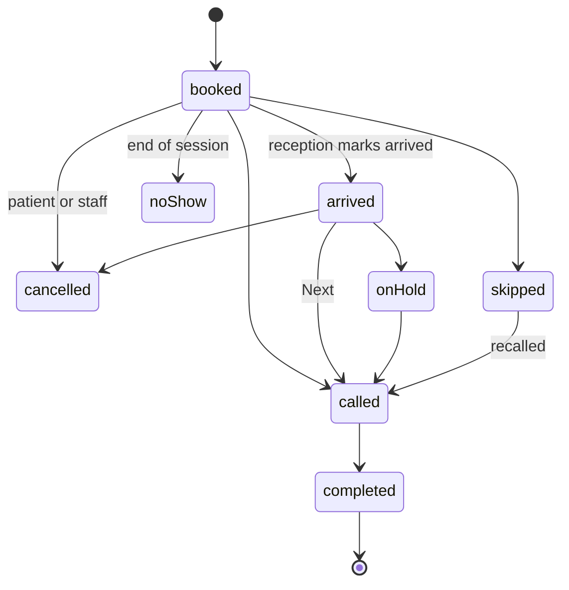

# DATABASE — Asani Firestore Schema

Source of truth for all collections. **Any schema change must update this file in the same PR.**

- Database: Cloud Firestore (Native mode), location **`asia-south1`**. ⚠️ The location cannot be changed after creation.
- Time zone for business dates: **Asia/Karachi**.
- Field names: `camelCase`. Enum values: `camelCase` strings.
- Every document has `createdAt`, and mutable documents have `updatedAt` (server timestamps).

---

## 1. Collections overview

| Collection | Phase | Written by | Read by (patient app) |
|---|---|---|---|
| `users/{uid}` | 1 | App (own doc) / Functions | Own doc |
| `users/{uid}/devices/{deviceId}` | 1 | App (own) | Own |
| `patients/{patientId}` | 1 | App (own) / Functions / *staff later* | Own profiles |
| `clinics/{clinicId}` | 1 | Admin script (*admin panel later*) | All signed-in users |
| `clinics/{clinicId}/private/billing` | 3 | Super admin only | ❌ never |
| `doctors/{doctorId}` | 1 | Admin script (*desktop later*) | All signed-in users |
| `doctors/{doctorId}/days/{yyyy-MM-dd}` | 1 | Functions / queue-sim (*desktop later*) | All signed-in users |
| `tokens/{tokenId}` | 1 | Functions / queue-sim (*desktop later*) | Own tokens (+ count queries) |
| `followUps/{followUpId}` | 1 | Admin script / Functions (*desktop later*) | Own |
| `clinics/{clinicId}/stats/{yyyy-MM}` | 2 | Functions | ❌ |
| `invoices/{id}`, `activityLogs/{id}` | 3 | Functions / super admin | ❌ |

---

## 2. `users/{uid}`

Doc ID = Firebase Auth uid.

| Field | Type | Notes |
|---|---|---|
| `phone` | string | E.164, e.g. `+923001234567`. Copied from Auth, read-only for the app |
| `name` | string | Account owner's name |
| `role` | string | `patient` for app users. Staff roles come from **custom claims** (Phase 2), never from this field |
| `city` | string | Last selected city, default `Lahore` |
| `consentAcceptedAt` | timestamp | Terms + privacy accepted |
| `consentVersion` | string | e.g. `2026-11-v1` |
| `selfPatientId` | string | ID of the user's "Self" profile in `patients` |
| `queueAlertsEnabled` | bool | Account-wide "Queue alerts" switch (Account screen), same on every phone. Missing = `true`. Queue notifications are sent only when `true` (D-18). The phone's own notification permission is stored on the device, not here |
| `createdAt`, `updatedAt`, `lastLoginAt` | timestamp | |

### `users/{uid}/devices/{deviceId}`
| Field | Type | Notes |
|---|---|---|
| `fcmToken` | string | Current FCM registration token |
| `platform` | string | `android` / `ios` |
| `appVersion` | string | |
| `updatedAt` | timestamp | Refreshed on app start and on token refresh |

`deviceId` = a random UUID stored on the device (not a hardware ID).

---

## 3. `patients/{patientId}`

One document per **person who sees a doctor**. Not a sub-collection of `users`, because walk-in patients (Phase 2) have no app account.

| Field | Type | Notes |
|---|---|---|
| `phone` | string | E.164 **account/contact phone**. Search key for reception |
| `ownerUid` | string \| null | App account that manages this profile; `null` for walk-ins until linked |
| `name` | string | Full name |
| `nameLower` | string | Lowercase, trimmed: for duplicate checks |
| `birthYear` | number | From age entered (current year − age). Display age = current year − birthYear |
| `gender` | string | `male` / `female` / `other` |
| `relation` | string | `self`, `mother`, `father`, `spouse`, `son`, `daughter`, `brother`, `sister`, `other` (relative to the owner) |
| `patientPhone` | string \| null | Patient's own number, optional |
| `status` | string | `active` / `deleted` / `merged` |
| `mergedInto` | string \| null | Phase 2+ |
| `personId` | string \| null | Phase 2+ cross-phone link |
| `createdBy` | string | `app` / `staff` / `script` |
| `createdAt`, `updatedAt` | timestamp | |

Rules of thumb:
- Exactly one `relation: self` per `ownerUid`.
- Never hard-delete; set `status: deleted`.
- Patients' identity at a clinic = `phone` + profile.

---

## 4. `clinics/{clinicId}`

| Field | Type | Notes |
|---|---|---|
| `name` | string | |
| `nameLower` | string | Search |
| `area` | string | e.g. `Johar Town` |
| `city` | string | e.g. `Lahore` |
| `address` | string | |
| `phone` | string | Reception number shown in app |
| `location` | geopoint \| null | For directions |
| `searchKeywords` | array<string> | Prefixes/words of name + area (generated by script) |
| `status` | string | `pilot` / `active` / `grace` / `suspended` / `cancelled` |
| `doctorCount` | number | Active doctors |
| `timezone` | string | `Asia/Karachi` |
| `printFormat` | string | `thermal80` / `a5` / `none` (Phase 2) |
| `createdAt`, `updatedAt` | timestamp | |

> **Billing fields (plan, monthlyFee, paidUntil, etc.) must NOT be on this document**, because every signed-in patient can read it. They go in `clinics/{clinicId}/private/billing` (Phase 3, super admin only).

Visible to patients: clinics with `status in [pilot, active, grace]`. `suspended` is readable (for Recent clinics) but booking is blocked.

---

## 5. `doctors/{doctorId}`

Top-level (not under clinics) so queries by `clinicId` are simple. A doctor working at two clinics has **two** documents.

| Field | Type | Notes |
|---|---|---|
| `clinicId` | string | |
| `name` | string | e.g. `Dr. Ayesha Malik` |
| `speciality` | string | |
| `qualification` | string \| null | e.g. `MBBS, FCPS` |
| `avgConsultMinutes` | number | Default 10. Used for wait estimate |
| `maxTokensPerDay` | number | Default 40 |
| `bookingWindowDays` | number | Default 7 (days ahead patients can book) |
| `tokenPrefix` | string | Letter shown before token numbers, e.g. `A` → "A-11" (D-13). Unique per clinic |
| `schedule` | map | Keys `mon`…`sun`; value `{start: "17:00", end: "21:00"}` or `null` (off) |
| `onLeaveDates` | array<string> | `yyyy-MM-dd` |
| `active` | bool | |
| `sortOrder` | number | Order on clinic page |
| `createdAt`, `updatedAt` | timestamp | |

---

## 6. `doctors/{doctorId}/days/{yyyy-MM-dd}`: queue day

One per doctor per date. Created by `bookToken` on the first booking of that day (or by reception when the session starts).

| Field | Type | Notes |
|---|---|---|
| `clinicId` | string | |
| `doctorId` | string | |
| `date` | string | `yyyy-MM-dd` (PKT), same as doc ID |
| `sessionStatus` | string | `notStarted` / `running` / `paused` / `ended` |
| `currentToken` | number | Number currently with the doctor. `0` = none called yet |
| `lastTokenNumber` | number | Highest number issued. **Only changed inside a transaction** |
| `activeNumbers` | array<number> | Sorted token numbers in `booked` / `arrived` / `onHold`. **Numbers only, no personal data.** The app uses it to compute "patients ahead". Maintained by `onTokenWrite` |
| `waitingCount` | number | `activeNumbers.length` |
| `bookedCount` | number | All tokens issued (for "18 of 40 booked") |
| `updatedAt` | timestamp | |

---

## 7. `tokens/{tokenId}`

| Field | Type | Notes |
|---|---|---|
| `clinicId` | string | |
| `doctorId` | string | |
| `date` | string | `yyyy-MM-dd` (PKT) |
| `number` | number | Sequential per doctor/day |
| `tokenPrefix` | string | Copied from the doctor at booking time, for display ("A-11") |
| `patientId` | string | → `patients` |
| `patientSnapshot` | map | `{name, birthYear, gender, relation, phone}` at booking time (staff view + slip) |
| `bookedByUserId` | string \| null | App user who booked; `null` for walk-in. Receives queue notifications |
| `patientOwnerUid` | string \| null | `ownerUid` of the patient profile. Lets the owner see visits booked by staff (walk-ins) after linking. Backfilled by `linkPatientProfiles` |
| `source` | string | `app` / `walkIn` / `followUp` |
| `status` | string | see below |
| `notified` | map | `{ahead3?, ahead2?, ahead1?, yourTurn?}` → timestamps |
| `followUpId` | string \| null | If booked from a follow-up |
| `createdAt` | timestamp | |
| `arrivedAt`, `calledAt`, `completedAt`, `cancelledAt` | timestamp \| null | |
| `cancelledBy` | string \| null | `patient` / `staff` |
| `waitMinutes` | number \| null | Set on `called`: `calledAt − (arrivedAt ?? createdAt)` |
| `updatedAt` | timestamp | |

### Token status flow



- **Active** statuses: `booked`, `arrived`, `called`, `onHold`
- **Counted as ahead:** `booked`, `arrived`, `onHold` with a lower number
- At session end (`sessionStatus: ended`), remaining `booked` tokens → `noShow` (function, Phase 2; queue-sim command in Phase 1).

---

## 8. `followUps/{followUpId}`

| Field | Type | Notes |
|---|---|---|
| `clinicId`, `doctorId` | string | |
| `patientId` | string | |
| `ownerUid` | string \| null | Copied from patient, so the app can query own follow-ups |
| `sourceTokenId` | string | Visit that created it |
| `dueDate` | string | `yyyy-MM-dd` |
| `note` | string \| null | Short, non-medical (e.g. "Review visit") |
| `status` | string | `pending` / `booked` / `done` / `missed` |
| `bookedTokenId` | string \| null | |
| `remindersSent` | number | 0–2 |
| `createdAt`, `updatedAt` | timestamp | |

---

## 9. Composite indexes (`firestore.indexes.json`)

| Collection | Fields | Used by |
|---|---|---|
| `clinics` | `city` ASC, `status` ASC, `nameLower` ASC | Home clinic list |
| `doctors` | `clinicId` ASC, `active` ASC, `sortOrder` ASC | Clinic page |
| `tokens` | `bookedByUserId` ASC, `status` ASC, `createdAt` DESC | My active tokens |
| `tokens` | `bookedByUserId` ASC, `createdAt` DESC | Past tokens |
| `tokens` | `patientOwnerUid` ASC, `patientId` ASC, `createdAt` DESC | Profile history (rules need the owner filter) |
| `tokens` | `patientId` ASC, `createdAt` DESC | Functions / staff (Phase 2) |
| `tokens` | `doctorId` ASC, `date` ASC, `status` ASC, `number` ASC | Queue position, notifications |
| `tokens` | `patientId` ASC, `doctorId` ASC, `date` ASC, `status` ASC | Duplicate check (BR-5) |
| `patients` | `ownerUid` ASC, `status` ASC, `createdAt` ASC | Family tab |
| `patients` | `phone` ASC, `ownerUid` ASC | Linking on login |
| `followUps` | `ownerUid` ASC, `status` ASC, `dueDate` ASC | Upcoming follow-ups |
| `followUps` | `status` ASC, `dueDate` ASC | Scheduled reminders |

If Firestore throws "The query requires an index", it prints a link; add the index to `firestore.indexes.json` (not only in the console) so it is versioned.

---

## 10. Example documents

```jsonc
// doctors/doc_ayesha/days/2026-11-07
{
  "clinicId": "cl_alshifa",
  "doctorId": "doc_ayesha",
  "date": "2026-11-07",
  "sessionStatus": "running",
  "currentToken": 7,
  "lastTokenNumber": 19,
  "activeNumbers": [8, 9, 10, 11, 12, 13, 14, 15, 16, 17, 18, 19],
  "waitingCount": 12,
  "bookedCount": 19
}

// tokens/tk_8f2a
{
  "clinicId": "cl_alshifa",
  "doctorId": "doc_ayesha",
  "date": "2026-11-07",
  "number": 11,
  "patientId": "pt_shazia",
  "patientSnapshot": { "name": "Shazia Begum", "birthYear": 1971, "gender": "female", "relation": "mother", "phone": "+923001234567" },
  "bookedByUserId": "uid_ali",
  "source": "app",
  "status": "booked",
  "notified": { "ahead3": "2026-11-07T12:41:00Z" }
}
```

---

## 11. Data retention

- Tokens and visits: kept while the clinic is a customer (visit history).
- Deleted accounts: `users` doc and devices removed; app-created profiles anonymised (`name: "Deleted user"`, phone removed) unless a clinic still needs the visit record.
- No diagnosis, medicines or reports are stored in Phase 1 (Stage 1 data only).
