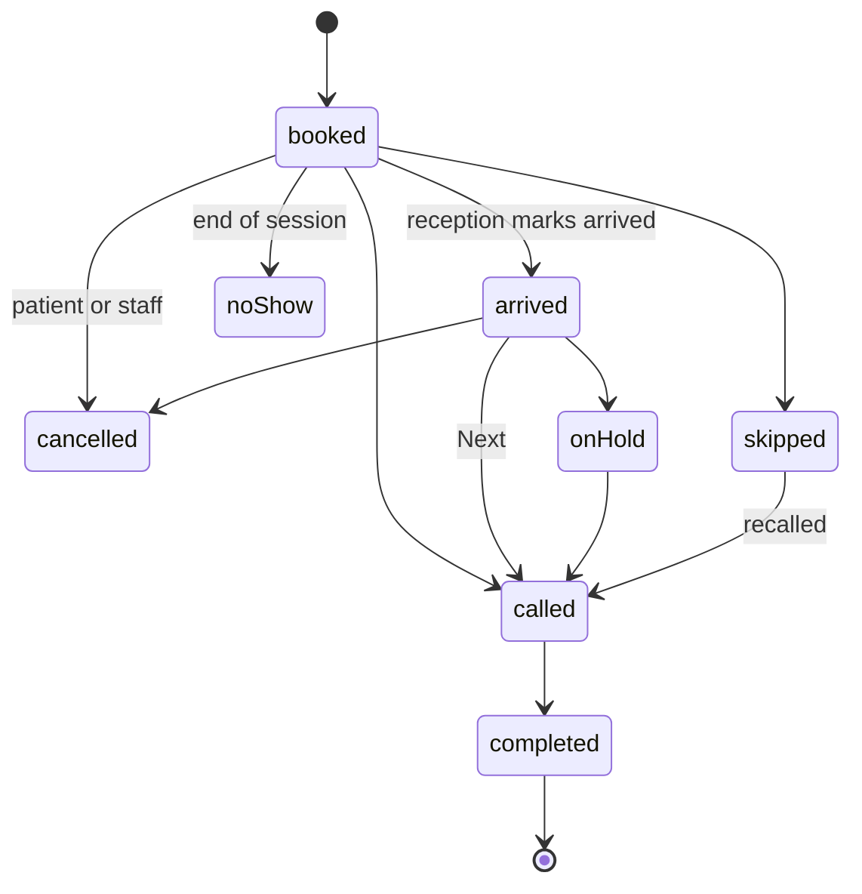

# DATABASE — Asani Firestore Schema

Source of truth for all collections. **Any schema change must update this file in the same PR.**

> **Moving to Supabase Postgres (D-52, docs/10-supabase-migration.md).** The tables are in
> `supabase/migrations/20261124000100_schema.sql` and the access rules (RLS) in `…000200_security.sql`.
> Until this file is rewritten (phase 8), the field descriptions below still apply with these changes:
> - field names are `snake_case` (`bookedByUserId` → `booked_by_user_id`); sub-collections are tables:
>   `users/{uid}/devices` → `devices`, `users/{uid}/notifications` → `notifications`,
>   `clinics/{id}/private/billing` → `clinic_billing`, `clinics/{id}/stats` → `clinic_stats`,
>   `doctors/{id}/private/admin` → `doctor_private`, `doctors/{id}/days` → `queue_days`, `settings/billing` → `billing_settings`;
> - `users` gets `email`, `phone` (**unique**: one phone = one app account) and `phone_verified` (always `false` for now);
> - `clinics.location` → `lat` + `lng`; `name_lower` columns are generated by the database;
> - `tokens` has a unique index on (`doctor_id`, `date`, `number`) and a foreign key to its queue day;
> - new backend-only table `push_outbox` (pushes waiting for the `send-push` Edge Function);
> - roles come from `app_metadata` (`role`, `clinic_id`), not custom claims; Firestore indexes → Postgres indexes in the migration.

- Database: Cloud Firestore (Native mode), location **`asia-south1`**. ⚠️ The location cannot be changed after creation.
- Time zone for business dates: **Asia/Karachi**.
- Field names: `camelCase`. Enum values: `camelCase` strings.
- Every document has `createdAt`, and mutable documents have `updatedAt` (server timestamps).

---

## 1. Collections overview

| Collection | Phase | Written by | Read by (patient app) |
|---|---|---|---|
| `users/{uid}` | 1 | App (own doc) / Functions | Own doc |
| `users/{uid}/devices/{deviceId}` | 1 | App (own) | Own |
| `patients/{patientId}` | 1 | App (own) / Functions / *staff later* | Own profiles |
| `clinics/{clinicId}` | 1 | Admin script (*admin panel later*) | All signed-in users |
| `clinics/{clinicId}/private/billing` | 3 | Super admin only | ❌ never |
| `doctors/{doctorId}` | 1 | Admin script (*desktop later*) | All signed-in users |
| `doctors/{doctorId}/days/{yyyy-MM-dd}` | 1 | Functions / queue-sim (*desktop later*) | All signed-in users |
| `tokens/{tokenId}` | 1 | Functions / queue-sim (*desktop later*) | Own tokens (+ count queries) |
| `followUps/{followUpId}` | 1 | Admin script / Functions (*desktop later*) | Own |
| `clinics/{clinicId}/stats/{yyyy-MM}` | 2 | Functions | ❌ (own clinic + super admin) |
| `clinicAccounts/{uid}` | 2 | Functions / admin script | ❌ (own login + super admin) |
| `adminUsers/{uid}` | 3 | Admin script | ❌ (super admin) |
| `invoices/{id}`, `activityLogs/{id}` | 3 | Functions only | ❌ (own clinic + super admin) |
| `settings/billing` | 3 | Functions (`saveAdminSettings`) | ❌ (clinic logins + super admin) |
| `doctors/{doctorId}/private/admin` | 2 | Functions only (`saveDoctor`, from the clinic) | ❌ (super admin only, D-33) |
| `doctorLinkSuggestions/{pairId}` | 2 | Functions only | ❌ (super admin only, D-32) |

---

## 2. `users/{uid}`

Doc ID = Firebase Auth uid.

| Field | Type | Notes |
|---|---|---|
| `phone` | string | E.164, e.g. `+923001234567`. Copied from Auth, read-only for the app |
| `name` | string | Account owner's name |
| `role` | string | `patient` for app users. Staff roles come from **custom claims** (Phase 2), never from this field |
| `city` | string | Last selected city, default `Lahore` |
| `consentAcceptedAt` | timestamp | Terms + privacy accepted |
| `consentVersion` | string | e.g. `2026-11-v1` |
| `selfPatientId` | string | ID of the user's "Self" profile in `patients` |
| `notificationsSeenAt` | timestamp (optional) | D-45: last time the notifications list was opened; newer entries are unread. Written by the app |
| `queueAlertsEnabled` | bool | Account-wide "Queue alerts" switch (Account screen), same on every phone. Missing = `true`. Queue notifications are sent only when `true` (D-18). The phone's own notification permission is stored on the device, not here |
| `createdAt`, `updatedAt`, `lastLoginAt` | timestamp | |

### `users/{uid}/notifications/{id}` (D-45)
| Field | Type | Notes |
|---|---|---|
| `type` | string | `queue` / `cancel` / `skip` / `followUp` |
| `title`, `body` | string | Same text as the push |
| `route` | string | Where a tap goes (`/token/{id}` or a booking route) |
| `tokenId` | string \| null | |
| `createdAt` | timestamp | |
| `expireAt` | timestamp | `createdAt` + 30 days. A **TTL policy** on it will delete old entries, but TTL needs Blaze (REMAINING_WORK §11); until then the app simply hides entries older than 30 days |

Written only by functions (`lib/inbox.ts`), with every push, even when alerts are off. The owner reads it; no client writes.

### `users/{uid}/devices/{deviceId}`
| Field | Type | Notes |
|---|---|---|
| `fcmToken` | string | Current FCM registration token |
| `platform` | string | `android` / `ios` |
| `appVersion` | string | |
| `updatedAt` | timestamp | Refreshed on app start and on token refresh |

`deviceId` = a random UUID stored on the device (not a hardware ID).

---

## 3. `patients/{patientId}`

One document per **person who sees a doctor**. Not a sub-collection of `users`, because walk-in patients (Phase 2) have no app account.

| Field | Type | Notes |
|---|---|---|
| `phone` | string | E.164 **account/contact phone**. Search key for reception |
| `ownerUid` | string \| null | App account that manages this profile; `null` for walk-ins until linked |
| `name` | string | Full name |
| `nameLower` | string | Lowercase, trimmed: for duplicate checks |
| `birthYear` | number | From age entered (current year − age). Display age = current year − birthYear |
| `gender` | string | `male` / `female` / `other` |
| `relation` | string | `self`, `mother`, `father`, `spouse`, `son`, `daughter`, `brother`, `sister`, `other` (relative to the owner) |
| `patientPhone` | string \| null | Patient's own number, optional |
| `status` | string | `active` / `deleted` / `merged` |
| `mergedInto` | string \| null | Phase 2+ |
| `personId` | string \| null | Phase 2+ cross-phone link |
| `createdBy` | string | `app` / `staff` / `script` |
| `clinicIds` | array<string> | Clinics this patient booked or visited. Set by `bookToken` and `clinicCreateWalkIn`; a clinic login can read the patient only if its clinic is in here (BW-6). Backfill: `tools/admin-scripts/backfill-clinic-ids.js` |
| `createdAt`, `updatedAt` | timestamp | |

Rules of thumb:
- Exactly one `relation: self` per `ownerUid`.
- Never hard-delete; set `status: deleted`.
- Patients' identity at a clinic = `phone` + profile.

---

## 4. `clinics/{clinicId}`

| Field | Type | Notes |
|---|---|---|
| `name` | string | |
| `nameLower` | string | Search |
| `area` | string | e.g. `Johar Town` |
| `city` | string | e.g. `Lahore` |
| `address` | string | |
| `phone` | string | Reception number shown in app |
| `location` | geopoint | **Required** (D-31): set in the new clinic wizard (A-04) and clinic settings (C-13). Used for Directions and for "nearest first" in the Doctors tab. Existing clinics: see migration below |
| `searchKeywords` | array<string> | Prefixes/words of name + area (generated by script) |
| `status` | string | `pilot` / `active` / `grace` / `suspended` / `cancelled` |
| `doctorCount` | number | Active doctors |
| `timezone` | string | `Asia/Karachi` |
| `printFormat` | string | `thermal80` / `a5` / `none` (Phase 2) |
| `nextDoctorLetter` | number | Index of the next doctor letter (0 = A). Letters are never reused (BW-7) |
| `createdAt`, `updatedAt` | timestamp | |

> **Billing fields (plan, monthlyFee, paidUntil, etc.) must NOT be on this document**, because every signed-in patient can read it. They go in `clinics/{clinicId}/private/billing` (Phase 3, super admin only).

Visible to patients: clinics with `status in [pilot, active, grace]`. `suspended` is readable (for Recent clinics) but booking is blocked.

---

## 5. `doctors/{doctorId}`

Top-level (not under clinics) so queries by `clinicId` are simple. A doctor working at two clinics has **two** documents; once the Super Admin links them they share `doctorGroupId` (D-32).

| Field | Type | Notes |
|---|---|---|
| `clinicId` | string | |
| `name` | string | e.g. `Dr. Ayesha Malik` |
| `speciality` | string | **One** key from the fixed list (PRD F-13, D-31, D-33), e.g. `heart`, `generalPhysician`, `other`. Never free text. The patient label + icon come from `asani_core`, not from Firestore |
| `city` | string | Copied from the clinic by `saveDoctor` (and when the clinic's city changes), so the Doctors tab can query `city + speciality + active` |
| `nameKey` | string | Normalised name for the weak match: lower case, `dr`/`dr.`/`doctor` prefix removed, punctuation and extra spaces removed, e.g. `ayesha malik`. Set by `saveDoctor` |
| `doctorGroupId` | string \| null | Shared by linked records of the same doctor (D-32). Set only by the Super Admin's Link / Unlink functions; `null` = not linked |
| `specialityFlagged` | bool (optional) | `true` when the migration could not map an old free-text speciality and set `other` (D-33); the clinic web asks the clinic to pick one. Cleared by `saveDoctor` |

> **No PMDC number on this document**: every signed-in patient can read `doctors`. It lives in `private/admin` below (D-33).

### `doctors/{doctorId}/private/admin` (D-33)
| Field | Type | Notes |
|---|---|---|
| `pmdcNumber` | string \| null | Optional (D-32). Stored normalised: trimmed, upper case, no spaces, e.g. `12345-P`. Loose check: digits, optional `-` + letter(s) |
| `clinicId` | string | Copy, for rules and the matching query |
| `updatedAt` | timestamp | |

- **Write:** only by `saveDoctor` (the clinic types it in Add / Edit doctor). No client writes.
- **Read:** only the `superAdmin` claim. The clinic login **cannot read it back** (the edit form shows "PMDC number on file · Change" from `hasPmdc` in the `saveDoctor` / doctor list response, never the number). Patients never receive it.
- Matching uses a **collection group** query on `private` (`pmdcNumber ==`; clinic billing docs in `private` have no such field), run only inside functions.
- The public doctor document only carries `hasPmdc: bool` (set by `saveDoctor`), so the clinic form can say "on file".
| `qualification` | string \| null | e.g. `MBBS, FCPS` |
| `avgConsultMinutes` | number | Default 10. Used for wait estimate |
| `maxTokensPerDay` | number | Default 40 |
| `bookingWindowDays` | number | Default 7 (days ahead patients can book) |
| `tokenPrefix` | string | Letter shown before token numbers, e.g. `A` → "A-11" (D-13). Unique per clinic |
| `schedule` | map | Keys `mon`…`sun`; value `{start: "17:00", end: "21:00"}` or `null` (off) |
| `onLeaveDates` | array<string> | `yyyy-MM-dd` |
| `active` | bool | |
| `sortOrder` | number | Order on clinic page |
| `addedBy` | string \| null | `clinic` when the clinic added it from the web (D-19) |
| `createdAt`, `updatedAt` | timestamp | |

---

## 6. `doctors/{doctorId}/days/{yyyy-MM-dd}`: queue day

One per doctor per date. Created by `bookToken` on the first booking of that day (or by reception when the session starts).

| Field | Type | Notes |
|---|---|---|
| `clinicId` | string | |
| `doctorId` | string | |
| `date` | string | `yyyy-MM-dd` (PKT), same as doc ID |
| `sessionStatus` | string | `notStarted` / `running` / `paused` / `ended` |
| `currentToken` | number | Number currently with the doctor. `0` = none called yet |
| `lastTokenNumber` | number | Highest number issued. **Only changed inside a transaction** |
| `activeNumbers` | array<number> | Sorted token numbers in `booked` / `arrived` / `onHold`. **Numbers only, no personal data.** The app uses it to compute "patients ahead". Maintained by `onTokenWrite` |
| `waitingCount` | number | `activeNumbers.length` |
| `bookedCount` | number | All tokens issued (for "18 of 40 booked") |
| `undo` | map \| null | Last Next, for "Undo last Next" (30 s): `{at, completedId, calledId, calledPrevStatus, prevCurrent}` |
| `updatedAt` | timestamp | |

---

## 7. `tokens/{tokenId}`

| Field | Type | Notes |
|---|---|---|
| `clinicId` | string | |
| `doctorId` | string | |
| `date` | string | `yyyy-MM-dd` (PKT) |
| `number` | number | Sequential per doctor/day |
| `tokenPrefix` | string | Copied from the doctor at booking time, for display ("A-11") |
| `patientId` | string | → `patients` |
| `patientSnapshot` | map | `{name, birthYear, gender, relation, phone}` at booking time (staff view + slip) |
| `bookedByUserId` | string \| null | App user who booked; `null` for walk-in. Receives queue notifications |
| `patientOwnerUid` | string \| null | `ownerUid` of the patient profile. Lets the owner see visits booked by staff (walk-ins) after linking. Backfilled by `linkPatientProfiles` |
| `source` | string | `app` / `walkIn` / `followUp` |
| `status` | string | see below |
| `notified` | map | `{ahead3?, ahead2?, ahead1?, yourTurn?}` → timestamps |
| `followUpId` | string \| null | If booked from a follow-up |
| `createdAt` | timestamp | |
| `arrivedAt`, `calledAt`, `completedAt`, `cancelledAt` | timestamp \| null | |
| `cancelledBy` | string \| null | `patient` / `clinic` |
| `cancelReason` | string \| null | Reason picked by the clinic (C-04); shown in the app and the cancel push (D-23) |
| `priorityAt` | timestamp (optional) | D-24: set when a Skipped patient checks in again (`arrive` / `backToQueue`); Next calls these first, oldest first. Removed on skip / hold |
| `cancelNotifiedAt` | timestamp (optional) | Set (claimed) just before the D-23 "cancelled by clinic" push, so it is sent once |
| `skipNotifiedAt` | timestamp (optional) | Set (claimed) just before the D-34 "You missed your turn" push, so it is sent once per token |
| `turnRepeatUsed` | bool (optional) | D-35: set when a skip clears `notified.yourTurn` so the patient gets one more "Your turn now" on recall; never cleared, so this happens at most once per token |
| `history` | array<map> | `{action, by, at, note?}` for every clinic action (C-04), e.g. `by: "Al-Shifa Clinic (clinic login)"` |
| `waitMinutes` | number \| null | Set on `called`: `calledAt − (arrivedAt ?? createdAt)` |
| `autoClosed` | bool (optional) | `true` when the 03:00 PKT job closed a past-day token (PRD D-21): Booked → `noShow`, Arrived/On hold/Called → `completed`. Missing on all other tokens |
| `updatedAt` | timestamp | |

### Token status flow



- **Active** statuses: `booked`, `arrived`, `called`, `onHold`
- **Counted as ahead:** `booked`, `arrived`, `onHold` with a lower number
- At session end (`sessionStatus: ended`), remaining `booked` tokens → `noShow` (function, Phase 2; queue-sim command in Phase 1).

---

## 8. `followUps/{followUpId}`

| Field | Type | Notes |
|---|---|---|
| `clinicId`, `doctorId` | string | |
| `patientId` | string | |
| `ownerUid` | string \| null | Copied from patient, so the app can query own follow-ups |
| `sourceTokenId` | string | Visit that created it |
| `dueDate` | string | `yyyy-MM-dd` |
| `note` | string \| null | Short, non-medical (e.g. "Review visit") |
| `status` | string | `pending` / `booked` / `done` / `missed` |
| `bookedTokenId` | string \| null | |
| `remindersSent` | number | 0–2 |
| `createdAt`, `updatedAt` | timestamp | |

---

## 8b. Clinic web collections (PRD-CLINIC-WEB §11)

### `clinicAccounts/{uid}` (one login per clinic, D-18)
| Field | Type | Notes |
|---|---|---|
| `email`, `clinicId`, `name` | string | `name` = manager / senior doctor |
| `status` | string | `invited` / `active` / `disabled` |
| `pinSet` | bool | D-41: a manager PIN exists (set by functions; the PIN itself is in `clinicPins`) |
| `invitedAt`, `lastLoginAt`, `passwordChangedAt`, `createdAt` | timestamp | |

The role itself is the Auth custom claim, never this document.

### `clinics/{clinicId}/private/billing`
`plan` (`pilot`/`basic`/`premium`), `planAfterPilot`, `monthlyFee`, `billingDay` (1–28), `pilotEndsAt`, `paidUntil`, `ownerName`, `ownerPhone`, `email`.

### `clinics/{clinicId}/stats/{yyyy-MM}`
`app`, `walkIn`, `tokens` counters (incremented by `bookToken` / `clinicCreateWalkIn`).

### `invoices/{id}` (ID `inv_{clinicId}_{yyyy-MM}`)
`clinicId`, `month`, `amount`, `dueDate`, `status` (`unpaid`/`overdue`/`paid`/`waived`), `payment {amount, method, reference, date, recordedBy}`, `waiveReason`, `reminderSentAt`.

### `activityLogs/{id}`
`clinicId` (null = global), `actor {uid, name, role}`, `action`, `target`, `at`. Written by functions only.

### `settings/billing`
`prices {pilot, basic, premium}`, `pilotDays`, `billingDay`, `dueDays`, `graceDays`, `suspendDays`, `paymentInstructions`.

### `adminUsers/{uid}`
`email`, `name`, `role: superAdmin` (display only; the claim is the truth).

### `doctorLinkSuggestions/{pairId}` (D-32, super admin only)
One document per **pair** of doctor records at **different clinics**. `pairId` = the two doctor IDs sorted and
joined with `_`, so the same pair can never get a second document.

| Field | Type | Notes |
|---|---|---|
| `doctorIds` | array<string> | The two doctor IDs, sorted |
| `clinicIds` | array<string> | Their clinics, same order |
| `strength` | string | `strong` (same `pmdcNumber`) / `weak` (same `nameKey` + same `speciality`) |
| `status` | string | `open` / `linked` / `notSame` / `unlinked` |
| `createdAt` | timestamp | |
| `decidedAt` | timestamp \| null | |
| `decidedBy` | map \| null | `{uid, name}` of the Super Admin |

- Created or upgraded (`weak` → `strong`) by `saveDoctor` when a doctor is added or its name, speciality or PMDC
  number changes. Only for doctors in the **same city** (D-33). Never created for two doctors of the **same**
  clinic or for a pair whose document is `notSame` or `unlinked` (both remembered: never suggested again, D-33).
- **Link** (`adminLinkDoctors`): gives both records the same `doctorGroupId` (reuses an existing group if one of
  them is already linked; new ID otherwise) and sets the pair to `linked`.
- **Not the same** (`adminMarkNotSame`): status `notSame`.
- **Unlink** (`adminUnlinkDoctor`): clears that record's `doctorGroupId` (a group left with one record is cleared
  too) and sets its pairs to `unlinked`.
- Each of the three writes an `activityLogs` entry: `doctorLinked`, `doctorNotSame`, `doctorUnlinked`
  (target = both doctors + clinics).
- No rules match for clinic logins or patients; only the `superAdmin` claim can read. Writes: functions only.

### Migration for D-31 / D-32 (one-time admin scripts, dev first)
- `speciality`: map today's free-text values to the fixed keys (e.g. "General Physician" → `generalPhysician`,
  "Cardiologist" → `heart`); anything unknown → `other` + `specialityFlagged: true` for the clinic to fix (D-33).
- `city`, `nameKey`: backfill from the clinic and the name.
- `clinics.location`: list clinics without it for the Super Admin to fill in; until then their doctors show last,
  without distance (D-33).
- Run the suggestion builder once over all doctors.

---

### `clinicPins/{clinicId}` (backend only, D-41)
`salt`, `hash` (scrypt of the 4-digit manager PIN), `failed` (wrong tries in a row), `lockedUntil` (ms, after 5 wrong),
`unlockedUntil` (ms, 15 min after a correct PIN), `updatedAt`. No rules match: clients (even the Super Admin) never read
it. Written by `clinicSetPin`, `clinicVerifyPin`, `adminResetClinicPin`; read by the PIN gate in `saveDoctor` (new),
`setDoctorActive` (deactivate) and `logExport`.

### `rateLimits/{id}` (backend only)
`phoneLookup_{clinicId}`: `{windowStart: ms, count, clinicId, updatedAt}` for the D-22 full-phone lookup
(30 per 10 minutes per clinic). No rules match, so clients can never read or write it.

Walk-ins (D-22): a walk-in on an app user's profile has `bookedByUserId: null` and `patientOwnerUid` = the
account. The app lists those with `patientOwnerUid == uid && source == "walkIn"` (equality only, no composite
index) and queue alerts go to `bookedByUserId ?? patientOwnerUid`.

## 9. Composite indexes (`firestore.indexes.json`)

| Collection | Fields | Used by |
|---|---|---|
| `clinics` | `city` ASC, `status` ASC, `nameLower` ASC | Home clinic list |
| `doctors` | `clinicId` ASC, `active` ASC, `sortOrder` ASC | Clinic page |
| `tokens` | `bookedByUserId` ASC, `status` ASC, `createdAt` DESC | My active tokens |
| `tokens` | `bookedByUserId` ASC, `createdAt` DESC | Past tokens |
| `tokens` | `patientOwnerUid` ASC, `source` ASC, `createdAt` DESC | My Tokens "Load older" walk-ins (beyond the live 100) |
| `tokens` | `patientOwnerUid` ASC, `patientId` ASC, `createdAt` DESC | Profile history (rules need the owner filter) |
| `tokens` | `patientId` ASC, `createdAt` DESC | Functions / staff (Phase 2) |
| `tokens` | `doctorId` ASC, `date` ASC, `status` ASC, `number` ASC | Queue position, notifications |
| `tokens` | `patientId` ASC, `doctorId` ASC, `date` ASC, `status` ASC | Duplicate check (BR-5) |
| `patients` | `ownerUid` ASC, `status` ASC, `createdAt` ASC | Family tab |
| `patients` | `phone` ASC, `ownerUid` ASC | Linking on login |
| `followUps` | `ownerUid` ASC, `status` ASC, `dueDate` ASC | Upcoming follow-ups |
| `followUps` | `status` ASC, `dueDate` ASC | Scheduled reminders |
| `tokens` | `clinicId` ASC, `date` ASC | Clinic web: today's queue, summary, export |
| `tokens` | `clinicId` ASC, `patientId` ASC, `date` DESC | Clinic web: patient history |
| `patients` | `clinicIds` CONTAINS, `phone` ASC | Clinic web: search by phone |
| `patients` | `clinicIds` CONTAINS, `nameLower` ASC | Clinic web: search by name |
| `followUps` | `clinicId` ASC, `dueDate` ASC | Clinic web: follow-ups |
| `followUps` | `patientId` ASC, `doctorId` ASC, `status` ASC | `setFollowUp`, `bookToken` |
| `invoices` | `clinicId` ASC, `status` ASC / `month` DESC | Billing, payments |
| `activityLogs` | `clinicId` ASC, `at` DESC | Clinic activity |
| `doctors` | `clinicId` ASC, `active` ASC | Doctor count |
| `doctors` | `city` ASC, `speciality` ASC, `active` ASC | Doctors tab (D-31); distance is sorted in the app |
| `doctors` | `doctorGroupId` ASC, `active` ASC | "Also sits at" (D-32) |
| `private` (collection group) | `pmdcNumber` ASC | Strong-match suggestions, functions only (single-field **collection-group** index exemption needed) |
| `doctors` | `nameKey` ASC, `speciality` ASC | Weak-match suggestions |
| `doctorLinkSuggestions` | `status` ASC, `createdAt` DESC | Super Admin "Possible same doctor" list |

If Firestore throws "The query requires an index", it prints a link; add the index to `firestore.indexes.json` (not only in the console) so it is versioned.

---

## 10. Example documents

```jsonc
// doctors/doc_ayesha/days/2026-11-07
{
  "clinicId": "cl_alshifa",
  "doctorId": "doc_ayesha",
  "date": "2026-11-07",
  "sessionStatus": "running",
  "currentToken": 7,
  "lastTokenNumber": 19,
  "activeNumbers": [8, 9, 10, 11, 12, 13, 14, 15, 16, 17, 18, 19],
  "waitingCount": 12,
  "bookedCount": 19
}

// tokens/tk_8f2a
{
  "clinicId": "cl_alshifa",
  "doctorId": "doc_ayesha",
  "date": "2026-11-07",
  "number": 11,
  "patientId": "pt_shazia",
  "patientSnapshot": { "name": "Shazia Begum", "birthYear": 1971, "gender": "female", "relation": "mother", "phone": "+923001234567" },
  "bookedByUserId": "uid_ali",
  "source": "app",
  "status": "booked",
  "notified": { "ahead3": "2026-11-07T12:41:00Z" }
}
```

---

## 11. Data retention

- Tokens and visits: kept while the clinic is a customer (visit history).
- Deleted accounts: `users` doc and devices removed; app-created profiles anonymised (`name: "Deleted user"`, phone removed) unless a clinic still needs the visit record.
- No diagnosis, medicines or reports are stored in Phase 1 (Stage 1 data only).
